<div align="center"> <h1>Arepa Express · API Gateway y RabbitMQ en Azure</h1> <p align="center"> <strong>Cristian Camilo Ortiz Sánchez</strong><br /> DOSW 1 · Semana 14<br /> Escuela Colombiana de Ingeniería Julio Garavito<br /> cristian.ortiz-s@mail.escuelaing.edu.co </p> </div>


## 1.	Sección 1 – API Gateway

### 1.1 Creación de los servicios
Lo primero es crear los servicios, para el caso de Arepa Express se crean inicialmente los servicios de menu y pedidos utilizando la arquitectura hexagonal. En las siguientes capturas se evidencia la ejecución del comando `mvn spring-boot:run` y la respuesta obtenida al solicitar el menu.
 
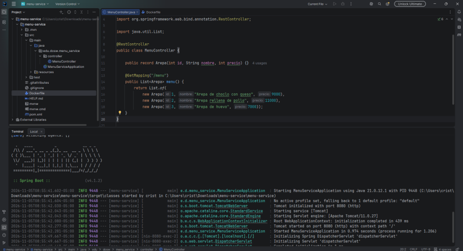
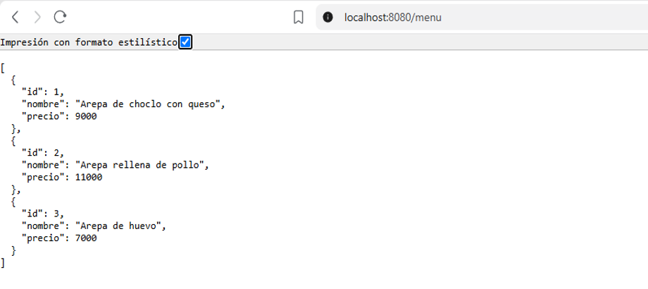

### 1.2 Despliegue en Azure
 
Después de hacer la implementación de los dos microservicios se realiza el despliegue en Azure, para ello se utilizan los siguientes comandos para empaquetar y publicar:

```bash
mvn -q package -DskipTests
az containerapp up --name menu-service --resource-group $RG --location $LOC \
  --environment arepas-env --source . --ingress external --target-port 8080
```

Una vez hecho, se tendrá una URL pública para cada servicio la cual va a ser usada más adelante por el API Gateway.

### 1.3 Creación del API Gateway
El siguiente paso es crear el API Gateway que es la capa con la cual el cliente va a interactuar de manera directa. El siguiente comando nos permite hacer eso:

```bash
az apim create --name arepas-gw-$NOMBRE --resource-group $RG --location $LOC \
--publisher-name "Arepa Express" --publisher-email cristian.ortiz-s@mail.escuelaing.edu.co \
--sku-name Consumption
```

### 1.4 Publicación del API Gateway y pruebas de llave
Después de esto, es necesario publicar las APIs en el Gateway con el objetivo de que el cliente solo accederá al Gateway para usar los servicios, en vez de tener que aprenderse cada URL.
La siguiente captura muestra la prueba del Gateway sin proporcionar la llave y como se puede ver, la respuesta es un código 401. Access Denied

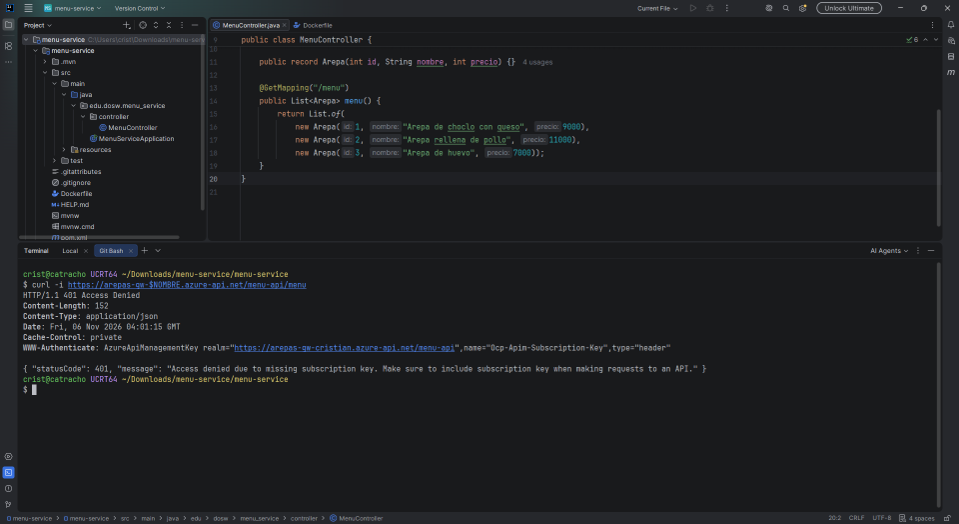

A continuación tambien se muestran los casos donde si se ingresa la llave y la respuesta es código 200 OK y 201 Created.

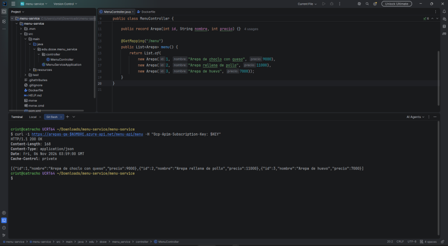
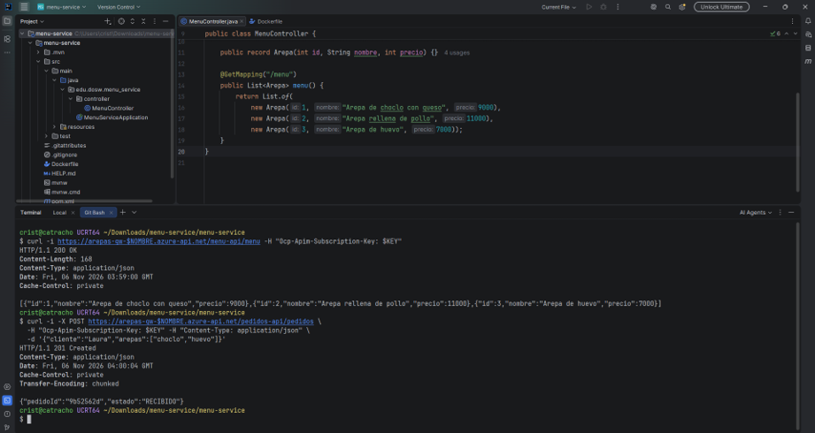

### 1.5 Políticas del Gateway

Para agregar políticas al Gateway se puede realizar desde el portal de Azure ingresando al servicio y configurando según sea la necesidad.

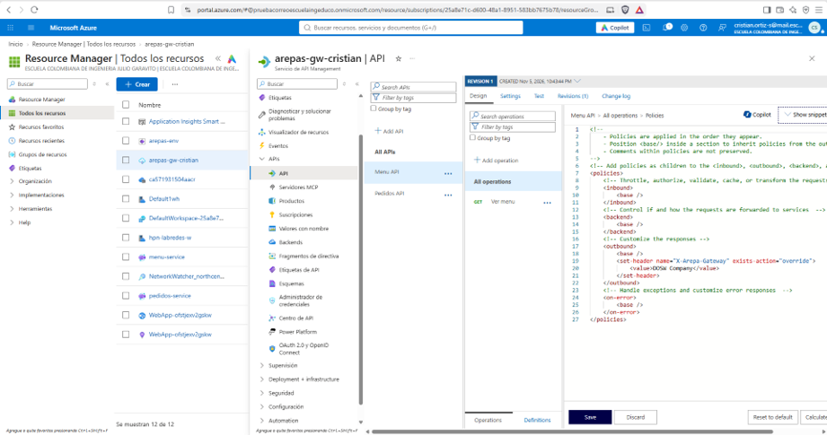

Como se observa en la siguiente captura, después de configurar el Gateway en Azure, la respuesta ahora incluye X-Arepa-Gateway

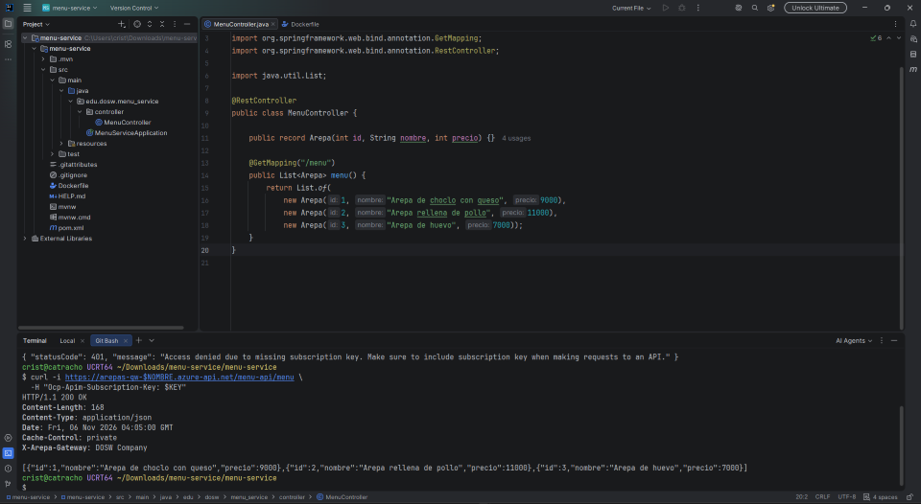

## 2. Sección 2 - Eventos

En esta seccion se agrega comunicación asincrona, cuando se crea un pedido no se llama directamente a los servicios de cocina o notificaciones sino que publica el evento en RabbitMQ y los listeners reciben el evento en su propia cola.

### 2.1 RabbitMQ

Primero es nececsario leveantar rabbit en Azure, así que se despliega como contenedor con una imagen que incluya el panel de administrador que se ve a continuacion:

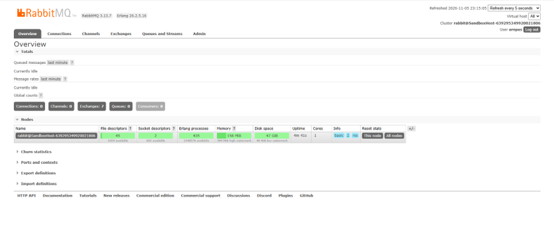

En este panel se pueden ver a qué colas se están enviando los mensajes y demás información.

### 2.3 Publicación y consumo del evento

pedidos-service publica el evento pedido.creado a través de un puerto de salida mientras que cocina-service recibe todo lo relacionado con pedidos.
notificaciones-service por su parte tiene su cola notificaciones.pedidos que recibe pedidos creados

### 2.4 Prueba de punta a punta

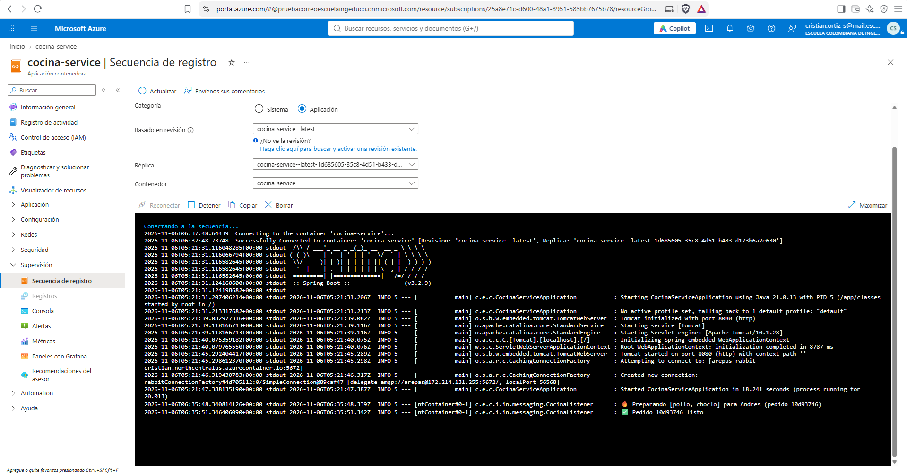
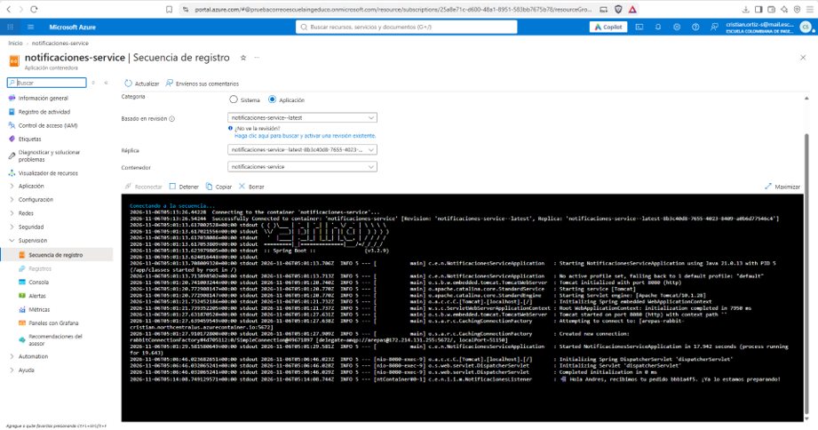
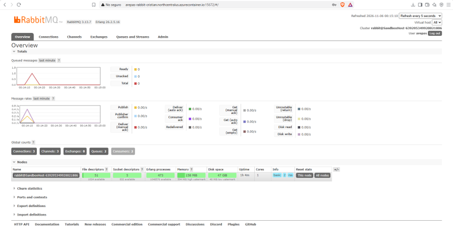

## 3. Experimentos
### 3.1 Uno a muchos

Un solo pedido llegó a cocina y a notificaciones porque los dos tienen su propia cola. Si los dos leyeran de la misma cola los mensajes se repartirían entre los dos servicios y entonces cada pedido lo recibiría solo uno de ellos.

3.2 Cola de trabajo

Se subió cocina-service a 2 réplicas y se enviaron 6 pedidos seguidos.

bash
az containerapp update --name cocina-service --resource-group $RG --min-replicas 2 --max-replicas 2

Resultado: la cola cocina.pedidos pasó a mostrar 2 consumers y cada pedido fue preparado por una sola réplica, repartiéndose el trabajo entre ambas.

<!-- Agrega aquí la captura de la cola con 2 consumers -->
3.3 Los mensajes esperan

Se creó la cola auditoria.pedidos y se unió al exchange arepas.eventos con la routing key pedido.#. Se enviaron 3 pedidos.

Resultado: como nadie consume esa cola, los 3 mensajes quedaron guardados. Esto es lo que permite que un servicio caído no pierda eventos.

---

## 4. Preguntas para pensar
 
**1. ¿Qué pasa con los pedidos si cocina-service se cae por 5 minutos?**
Los pedidos no se pierden porque se acumulan en la cola mientras el servicio está caído, después de los 5 minutos empezará a sacar de la cola con normalidad.
 
**2. ¿Por qué el Gateway devuelve 401 sin que el servicio se entere?**
Porque el Gateway esta antes de los servicios y es el que valida la llave de suscripción antes de enviar la peticion. Osea que si falla, no llega a los servicios
 
**3. ¿Dónde validarías el token de un usuario: en el Gateway o en cada microservicio?**
En el Gateway porque evita repetir la misma logica en cada microservicio, creo que sería más fácil de mantener porque toda la logica de autenticación está centralizada.
 
**4. ¿Qué pasa si el pedido se crea pero el evento no se alcanza a publicar?**
En ese caso existiria una inconsistencia y se debería buscar una forma de que el broker confirme la información.
 
**5. ¿Cuándo usarías una cola y cuándo un tópico en Style Radar?**
Usaría una cola para el tema de procesamiento de pagos y el tópico principalmente para cuando se compra una prenda, ya que hay varios microservicios que estarían interesados. El microservicio de inventario, el microservicio de notificaciones, el de item catalogo.

---

## 5. Repositorios
 
| Servicio | Enlace |
|---|---|
| `menu-service` | [https://github.com/CatrachoINXS/ArepaExpress-MenuService](https://github.com/CatrachoINXS/ArepaExpress-MenuService)  |
| `pedidos-service` | [https://github.com/CatrachoINXS/ArepaExpress-PedidoService](https://github.com/CatrachoINXS/ArepaExpress-PedidoService)  |
| `cocina-service` | [https://github.com/CatrachoINXS/ArepaExpress-CocinaService](https://github.com/CatrachoINXS/ArepaExpress-CocinaService)  |
| `notificaciones-service` | [https://github.com/CatrachoINXS/ArepaExpress-NotificacionesService](https://github.com/CatrachoINXS/ArepaExpress-NotificacionesService) |
